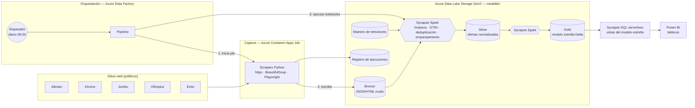

# Etapa 1 — Requerimientos y arquitectura del sistema de seguimiento de precios

**Versión:** 0.2 (13 de octubre de 2026). Cambio de categoría a **Televisores**; Falabella descartada. Las secciones 2 y 5 tienen notas de actualización de la Etapa 2.
**Objetivo específico que cubre:** *Definir la arquitectura y los requerimientos del sistema de seguimiento de precios, incluido el criterio de emparejamiento por código EAN o referencia del fabricante, antes de iniciar el desarrollo.*

| Versión | Cambio |
|---|---|
| 0.1 | Primer alcance: iPhone en cinco cadenas (archivado en `archivo/iphone/`) |
| 0.2 | Categoría Televisores, cuatro cadenas, alternativa por referencia del fabricante y universo de productos como unión de las cadenas ([Anexo A2](anexos/A2_viabilidad_televisores.md)) |

---

## 1. Propósito y alcance

El sistema captura a diario el precio, la disponibilidad y la identificación de los **televisores nuevos vendidos directamente por cada cadena**. Los datos se almacenan con historial en Azure y se analizan en Power BI.

**Incluido:** televisores de todas las marcas con tecnología vigente (LED, QLED, QNED, NanoCell, OLED, Mini LED), vendidos por el propio retailer.
**Excluido:** equipos usados, reacondicionados o de exhibición; combos (TV + otro producto); ofertas de vendedores externos del marketplace; tecnologías descontinuadas (CRT, LCD, plasma, DLP); monitores y pantallas industriales.

> **Impacto en el planteamiento:** el texto del TFM menciona "teléfonos móviles marca Apple" y "cinco cadenas". Hay que actualizarlo a **televisores** y **cuatro cadenas (cinco sitios web)**. Esto afecta al resumen, la introducción, la motivación, el objetivo general y los objetivos específicos.

## 2. Fuentes

Son cuatro cadenas y cinco sitios web. La viabilidad se verificó el 13 de octubre de 2026 (anexos [A1](anexos/A1_viabilidad_fuentes.md) y [A2](anexos/A2_viabilidad_televisores.md)); la configuración está en `config/fuentes.yaml`.

| Cadena | Sitio(s) | Vía de captura | ¿Publica EAN? | TV propios con stock (13-oct) |
|---|---|---|---|---|
| Alkosto/Ktronix | alkosto.com, ktronix.com | Ficha `/p/{EAN}` (HTML + microdatos) | Sí | 36 / 37 de 91 EAN de muestra |
| Grupo Éxito | exito.com | Listado con navegador (Playwright); ficha por HTTP | Sí (confirmado en la Etapa 2) | 245 (Etapa 2) |
| Jumbo | jumbocolombia.com | API pública de catálogo VTEX (JSON) | Sí | 59 |
| Olímpica | olimpica.com | API pública de catálogo VTEX (JSON) | Sí | 67 |

**Descartada:** Falabella, porque no publica EAN ni referencia del fabricante.

**Política de captura responsable:** solo información pública, cumplimiento del `robots.txt` de cada sitio, una petición a la vez por sitio con una pausa mínima de 1,5 s, User-Agent identificable y ninguna evasión de bloqueos. Si un sitio bloquea, se registra la falla; no se intenta esquivarla.

## 3. Universo de productos

### 3.1 Maestro de Alkosto (referencia inicial)

**Fuente:** hoja `DIM_PRODUCTO` (División *Video*, Línea *Tv*) del archivo `DataFeed-30-09-2026.xlsx`.
**Proceso:** el script `src/catalogo/construir_maestro.py` genera `data/maestro/maestro_televisores.csv`.

| Concepto | Valor |
|---|---|
| Registros Video / Tv | 4.659 (4.562 EAN únicos) |
| GTIN con dígito de control válido | 3.992 |
| Tecnología vigente | 2.661 |
| Combos excluidos | 543 |
| **Televisores en alcance** | **2.387** |
| Con marca / pulgadas / referencia identificadas | 2.355 / 2.379 / 2.372 |

### 3.2 Unión de las cadenas
Como se comparan todas las cadenas entre sí, `dim_producto` será la **unión** de:

1. El maestro de Alkosto.
2. Los televisores propios que se descubran en Éxito, Jumbo y Olímpica, aunque Alkosto no los venda (por ejemplo, Caixun, Hisense u Olimpo).

La clave de la dimensión es el GTIN-14. Los atributos del producto se toman primero del maestro y, si el producto no está en él, del título de la tienda.

## 4. Datos a capturar

### 4.1 Registro de captura (nivel Bronze → Silver)

| Campo | Descripción | Obligatorio |
|---|---|---|
| `id_ejecucion` | Identificador único de la corrida | Sí |
| `fecha_captura` | Fecha y hora UTC y Colombia (America/Bogota) | **Sí** |
| `cadena`, `sitio` | Origen del dato | Sí |
| `sku_tienda` | Identificador interno de la tienda | Sí |
| `ean_publicado` | EAN tal como aparece en el sitio | No |
| `titulo` | Descripción del producto en la tienda | **Sí** |
| `marca`, `pulgadas`, `referencia` | Extraídos del título | No |
| `url` | URL de la ficha | Sí |
| `vendedor`, `es_vendedor_propio` | Quién vende la oferta | Sí |
| `precio_lista` | Precio antes de descuento | No |
| `precio_venta` | Precio vigente al público | **Sí** |
| `precio_medio_pago` | Precio con tarjeta propia, si existe | No |
| `disponible` / `stock` | Disponibilidad (y unidades, si el sitio las publica) | Sí / No |
| `estado_extraccion` | `OK`, `NO_ENCONTRADO`, `SIN_STOCK`, `ERROR_HTTP`, `ERROR_PARSEO`, `BLOQUEADO` | Sí |
| `metodo` | `http_json`, `http_html` o `navegador` | Sí |
| `ruta_bronze` | Archivo crudo del que proviene el registro (trazabilidad) | Sí |

**Registro completo:** el que tiene identificador (`ean_publicado` o `sku_tienda`), precio de venta, descripción y fecha de captura.

### 4.2 Registro de ejecuciones

Cada corrida, por sitio, deja estos campos: `id_ejecucion`, `sitio`, `inicio`, `fin`, `duracion_s`, `consultados`, `ok`, `no_encontrados`, `errores`, `estado` (EXITOSA / PARCIAL / FALLIDA) y `mensaje`.

## 5. Periodicidad

| Modo | Frecuencia | Qué hace |
|---|---|---|
| **Descubrimiento** | Semanal (domingo) | Recorre la categoría de televisores en Jumbo, Olímpica y Éxito, y consulta en Alkosto y Ktronix los EAN del maestro y los descubiertos. Actualiza la tabla de correspondencias producto–tienda. |
| **Seguimiento** | Diario (06:00, hora de Colombia) | Consulta las fichas emparejadas y activas, más el listado de categoría para detectar novedades. Meta: menos de 60 minutos de punta a punta. |

Recorrer los 2.387 EAN del maestro en Alkosto y Ktronix a 1,5 s por petición tomaría alrededor de una hora por sitio. **Actualización (Etapa 2):** los sitemaps públicos listan las fichas de televisores, así que el descubrimiento completo de los cinco sitios toma unos 19 minutos y no hace falta el barrido de EAN (ver [Etapa 2](02_Etapa2_Extraccion.md), sección 3).

**Precio diario:** si en un día hay varias capturas de un mismo producto y tienda, se toma **la última** (decisión del equipo).

## 6. Regla de emparejamiento

Se aplica en orden y cada emparejamiento guarda el método con el que se hizo:

| Nivel | Método | Regla | Confianza |
|---|---|---|---|
| 1 | `EAN` | GTIN-14 de la tienda = GTIN-14 de otra tienda o del maestro, con dígito de control válido | Alta |
| 2 | `REFERENCIA` | Misma clave `marca \| pulgadas \| referencia normalizada`; acepta sufijos regionales (`HYLED4326` ≈ `HYLED4326QG`) si hay una sola coincidencia | Media |
| — | `SIN_EMPAREJAR` | Se conserva en Silver para revisión manual | — |

La **referencia normalizada** quita la marca, los prefijos de familia (`UN`, `KDL`…), las pulgadas iniciales y los sufijos de características (`FHD`, `UHD`, `T2`…). Por ejemplo, `65TG380` y `TG380` quedan iguales. Las pulgadas forman parte de la clave porque los fabricantes repiten la referencia de la serie en todos los tamaños.

**Exclusiones previas al emparejamiento:**
1. Vendedor distinto de la cadena.
2. Título con "reacondicionado", "usado", "exhibición", "open box" o "demo".
3. Combos ("combo", "+ barra"…).
4. Accesorios (soporte, control, mueble, antena…).
5. Precio de venta igual a 0.

En la prueba con los 126 televisores propios de Jumbo y Olímpica, 88 se emparejaron por EAN y 1 por referencia. Los demás eran marcas que Alkosto no vende; se emparejarán entre Jumbo, Olímpica y Éxito gracias al universo de unión (sección 3.2).

## 7. Requerimientos

### 7.1 Funcionales
| ID | Requerimiento |
|---|---|
| RF-01 | Construir y versionar el maestro de televisores a partir de `DIM_PRODUCTO`. |
| RF-02 | Capturar, para cada sitio, los campos de la sección 4.1 de los televisores propios. |
| RF-03 | Guardar la respuesta cruda (JSON o HTML comprimido) de cada captura en la capa Bronze. |
| RF-04 | Normalizar precios a enteros en COP, validar el GTIN y eliminar duplicados (Silver). |
| RF-05 | Emparejar ofertas entre cadenas y con el maestro según la sección 6 y registrar el método usado. |
| RF-06 | Generar la tabla de hechos de precio diario, con la última captura del día: un registro por producto, tienda y día (Gold). |
| RF-07 | Registrar cada ejecución por sitio (sección 4.2) y avisar cuando un sitio falle. |
| RF-08 | Publicar tableros con menor precio por producto, brecha porcentual entre cadenas y evolución diaria, con filtros por marca, pulgadas y tecnología. |

### 7.2 No funcionales
| ID | Requerimiento | Meta |
|---|---|---|
| RNF-01 | Tiempo de la ejecución diaria completa (captura + transformación) | < 150 min (era < 60 min; se ajustó el 19-nov-2026, ver nota) |
| RNF-02 | Completitud de campos obligatorios | ≥ 90 % |
| RNF-03 | Cobertura: televisores propios que cada cadena exhibe y se capturan | ≥ 90 % |
| RNF-04 | Duplicados en el historial diario | 0 |
| RNF-05 | Trazabilidad de cada valor de Gold hasta su archivo Bronze | 100 % |
| RNF-06 | Configuración externa (sitios, pausas, selectores) sin tocar el código | `config/*.yaml` |
| RNF-07 | Costo dentro del crédito de Azure for Students | Ver sección 9.3 |

> **Nota sobre el RNF-01 (19-nov-2026, decisión del grupo).** La meta inicial de 60 minutos se cumplió hasta el 12-nov (unos 30 min). Desde que Éxito exige superar el desafío de Cloudflare con un navegador (Scrapling), ese sitio usa un presupuesto fijo de 110 minutos y la ejecución completa tarda entre 120 y 125 minutos. La meta se ajustó a 150 minutos, igual al tiempo máximo que la pipeline de captura espera al job. Si un intento falla, `pl_orquestador_diario` lo reintenta hasta dos veces con 20 minutos de pausa; cada intento se mide por separado.

## 8. Herramientas recomendadas

| Necesidad | Recomendación | Motivo |
|---|---|---|
| Lenguaje | Python 3.12 | Estable con Playwright, pandas y PySpark. |
| API JSON (Jumbo, Olímpica) y HTML estático (Alkosto, Ktronix) | **httpx + BeautifulSoup/lxml** | Más rápido y estable que abrir un navegador; 4 de los 5 sitios no lo necesitan. |
| Sitio que carga en el cliente (Éxito) | **Playwright** en lugar de Selenium | Gestiona sus propios navegadores (se acaban los problemas de *chromedriver* del CoE131), espera automáticamente a los elementos, puede leer el JSON que la página recibe y tiene una imagen Docker oficial para Azure. |
| Validación de datos | pydantic | Esquema único del registro de captura. |
| Pruebas | pytest con HTML/JSON guardados como *fixtures* | Detecta cambios de estructura sin depender de la web en vivo. |
| Transformación | PySpark en Synapse Spark, con tablas Delta | Coincide con el planteamiento y permite reprocesar Bronze. |

## 9. Arquitectura

### 9.1 Diagrama

### 9.2 Componentes

| Capa | Servicio | Uso |
|---|---|---|
| Orquestación | Azure Data Factory | Disparador diario y semanal. Inicia el job de captura (actividad Web con identidad administrada), espera a que termine y lanza los notebooks de Spark. |
| Cómputo de captura | **Azure Container Apps Job** (plan por consumo) | Ejecuta la imagen Docker con Python y Playwright. Data Factory no corre Python con navegador por sí solo; es la opción más simple y barata frente a Azure Batch o una VM encendida. |
| Imágenes | Azure Container Registry Basic o GitHub Container Registry | Si se usa GitHub, se ahorra el costo del registro. |
| Almacenamiento | ADLS Gen2 | Contenedores `bronze/`, `silver/`, `gold/`, `maestro/` y `logs/`, particionados por `sitio/fecha=AAAA-MM-DD/`. |
| Transformación | Synapse Spark pool (pequeño, con autopausa) | Bronze → Silver → Gold en tablas Delta. |
| Modelo analítico | **Synapse SQL serverless** | Vistas sobre las tablas Delta de Gold. Se evita el *dedicated SQL pool* porque su costo por hora agotaría el crédito. |
| Visualización | Power BI (licencia disponible en el equipo) | Actualización programada diaria y publicación para los usuarios comerciales. |

### 9.3 Consideraciones de la suscripción de estudiante (pendientes de confirmar)

- **Crédito limitado.** Lo que más consume es el Spark pool. Mitigación: nodos pequeños, autopausa a los 5–10 minutos y una sola sesión diaria.
- **Regiones permitidas.** Elegir una región donde estén disponibles Synapse, Container Apps y Data Factory, y usarla para todo.
- **Cuotas.** Verificar la cuota de vCores de Spark para Synapse antes de la Etapa 3. Si no alcanza, el plan B es transformar con pandas o DuckDB dentro del mismo Container Apps Job, manteniendo las capas del medallón.

### 9.4 Modelo estrella (detalle en la Etapa 4)

- **`fact_precio_diario`**: `fecha_key`, `producto_key`, `tienda_key`, `precio_lista`, `precio_venta`, `precio_medio_pago`, `disponible`, `metodo_emparejamiento`, `id_ejecucion`, `ruta_bronze`. Un registro por producto, tienda y día, con la última captura del día.
- **`dim_producto`**: GTIN-14, marca, pulgadas, rango de pulgadas, referencia, tecnología, resolución y origen del atributo (maestro o tienda).
- **`dim_tienda`**: cadena y sitio.
- **`dim_calendario`**.

## 10. Métricas de validación (Etapa 6)

| Métrica | Definición operativa | Meta |
|---|---|---|
| Completitud | Registros con los 4 campos obligatorios / registros capturados | ≥ 90 % |
| Cobertura | TV propios capturados / TV propios que el sitio muestra en su categoría ese día | ≥ 90 % |
| Emparejamiento | Productos emparejados / productos presentes en ≥ 2 cadenas | ≥ 80 % |
| Exactitud de precio | Muestra aleatoria contrastada a mano con el sitio: precio idéntico al capturado | ≥ 80 % |
| Tiempo de proceso | Duración de la ejecución diaria completa | < 60 min |
| Reducción de esfuerzo | 1 − (horas de supervisión automática / horas de revisión manual equivalente) | ≥ 75 % |

## 11. Qué se reutiliza del proyecto CoE131

| Elemento del código anterior | Qué se hace con él |
|---|---|
| Estados por producto (Disponible, No disponible, URL no disponible, No se obtuvo HTML, Sin URL) | Se conservan como `estado_extraccion` (sección 4.1). |
| `Informe_Totales` y archivos de respuesta Correcto/Error | Pasan a ser el registro de ejecuciones (sección 4.2), que Data Factory puede leer. |
| Ejecución paralela por competidor (`hilos_competidor.py`) | Se reemplaza por concurrencia por sitio dentro de un solo proceso, con pausas por sitio. |
| Validación de insumos de `main.py` | Se convierte en la validación del maestro (GTIN y conteos). |
| Pruebas unitarias por competidor | Se mantiene la idea, pero con pytest y páginas guardadas como *fixtures*. |
| Lógica de Éxito y Jumbo | **No se reutiliza:** los selectores CSS de 2023 ya no aplican y Jumbo y Olímpica tienen API pública. |
| Selenium, `chromedriver.exe`, `Rutas Respuestas.txt`, listas manuales de URL | **Se descarta:** se sustituye por Playwright, configuración YAML y búsqueda por EAN. |
| D1, Makro y PriceSmart | Fuera del alcance del TFM. |

## 12. Cronograma propuesto (16 semanas)

| Semanas | Etapa | Entregable |
|---|---|---|
| S1 | 1. Requerimientos y arquitectura | Este documento, el maestro y las pruebas de viabilidad |
| S2–S4 | 2. Extracción | Scrapers de los 5 sitios, con pruebas. **La captura diaria en local empieza en S4** para acumular historial |
| S4–S7 | 3. Orquestación y medallón en Azure | Data Factory, Container Apps Job, Bronze, Silver y Gold, registro de ejecuciones |
| S7–S8 | 4. Modelo de datos | Modelo estrella en Synapse SQL serverless |
| S8–S9 | 5. Tableros | Power BI con actualización diaria |
| S9–S12 | 6. Validación | 4 semanas de datos en producción y medición de las métricas de la sección 10 |
| S13–S16 | Cierre | Evaluación con usuarios comerciales, análisis de resultados, redacción y defensa |

## 13. Riesgos

| Riesgo | Impacto | Mitigación |
|---|---|---|
| Éxito cambia su frontal o bloquea el navegador automatizado | Una cadena sin datos | Playwright con ritmo bajo; registrar la falla y documentarla como limitación |
| Cambios en la estructura de los sitios | Capturas fallidas | Configuración externa, *fixtures* de prueba y alertas en el registro de ejecuciones |
| Referencias con sufijos regionales distintos entre tiendas | Emparejamientos perdidos | Regla de prefijo con coincidencia única y revisión de `SIN_EMPAREJAR` |
| Agotar el crédito de Azure | Interrupción del servicio | Autopausa, sin pools dedicados, alertas de presupuesto y plan B de transformación en el contenedor |
| Combos o promociones con regalo mal clasificados | Precios no comparables | Lista de exclusión ampliable en la configuración |

## 14. Pendientes por confirmar

1. **Planteamiento:** actualizar el texto del TFM a "televisores" y "cuatro cadenas" (sección 1).
2. **Azure:** región, cuota de Spark y presupuesto de la suscripción de estudiante (sección 9.3).
