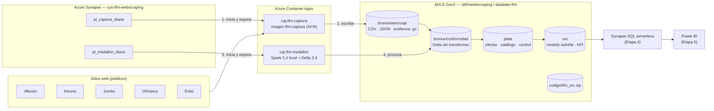

# Etapa 3 — Orquestación en Azure y arquitectura medallón

**Versión:** 0.2 (15 de octubre de 2026). La captura y el medallón ya corren en Azure (sección 9). El medallón usa Spark local en un Container Apps Job (opción B, sección 9.3), porque la cuota de Spark de Synapse es 0.
**Objetivo específico que cubre:** *Implementar la orquestación de la captura y la transformación de los datos en una arquitectura medallón (bronce, plata y oro) sobre Azure.*
**Requerimientos que atiende (Etapa 1):** RF-03, RF-04, RF-05, RF-06, RF-07, RNF-01, RNF-04, RNF-05, RNF-07.

---

## 1. Entregables

| Entregable | Ubicación |
|---|---|
| Imagen Docker de captura (Python 3.12 + Chromium de Playwright) | `Dockerfile`, `requirements-contenedor.txt` |
| Punto de entrada del contenedor (estado → extracción → lago) | `src/nube/tarea.py` |
| Escritura en la zona de aterrizaje de ADLS Gen2 | `src/nube/lago.py` |
| Medallón en PySpark + Delta: conformidad, plata y oro | `src/medallon/` |
| Imagen y job del medallón (Spark 3.4 local, opción B) | `medallon.Dockerfile`, `requirements-medallon.txt`, `src/nube/tarea_medallon.py` |
| Notebook de Synapse que ejecuta el medallón (opción A, si se aprueba la cuota) | `synapse/notebooks/nb_medallon_semanal.ipynb` |
| Pipelines de Synapse (captura diaria y medallón semanal) | `synapse/pipelines/` |
| Script de despliegue repetible | `infra/desplegar.ps1` |
| Pruebas del medallón con Spark 3.4 en Docker | `tests_spark/` |
| Recursos desplegados en Azure | Sección 7 |

## 2. Arquitectura implementada



### 2.1 Cambios respecto a la arquitectura de la Etapa 1 (sección 9)

| Etapa 1 | Implementado | Motivo |
|---|---|---|
| Azure Data Factory para orquestar | **Pipelines de Synapse** | Synapse ya incluye el mismo motor de pipelines y ejecuta notebooks de su propio pool sin servicios enlazados extra. Un recurso menos que configurar y vigilar. |
| ACR Basic o GitHub Container Registry | **ACR Basic** | Decisión del equipo: la identidad administrada del job descarga la imagen sin credenciales guardadas. |
| Contenedores `bronze/`, `silver/`, `gold/`… | **Un contenedor** `datalake-tfm` con carpetas `bronce/`, `plata/`, `oro/` y `codigo/` | Estructura definida por el equipo; la zona de aterrizaje se separa de la conformidad dentro de bronce. |
| Spark en el pool de Synapse | **Spark 3.4 en modo local dentro de un Container Apps Job** (`caj-tfm-medallon`) | La cuota de vCores de Spark del área de trabajo es 0 (sección 9). Se usa el mismo código `src/medallon` y el mismo runtime (Spark 3.4, Delta 2.4); el notebook y el pool quedan para la opción A. |
| Spark diario | **Spark semanal**; la captura sigue siendo diaria | El Spark pool es lo que más consume del crédito (RNF-07). Plata y oro se reconstruyen cada semana con todos los días capturados, así que no se pierde ningún precio diario: solo cambia la frescura de los tableros. |

## 3. Captura en Azure Container Apps Job

- **Imagen:** `mcr.microsoft.com/playwright/python:v1.63.0-noble` (Python 3.12 y Chromium), con el usuario sin privilegios `pwuser` y la zona horaria `America/Bogota`. Se publica como `acrtfmwebscraping.azurecr.io/tfm-captura:0.3`.
- **Job `caj-tfm-captura`:** disparo manual (lo inicia la pipeline), 1 vCPU, 2 GiB, una réplica, sin reintentos y un tiempo máximo de 2 horas.
- **Identidad `id-tfm-captura`** (asignada por el usuario): AcrPull sobre el registro y Storage Blob Data Contributor sobre el lago. No hay claves ni cadenas de conexión en la imagen ni en las variables del job.
- **Flujo de `src/nube/tarea.py`:**
  1. baja `estado/ultimo_estado.json` de cada sitio (fichas descubiertas en la última corrida completa);
  2. corre la extracción de la Etapa 2 en una carpeta temporal. El modo depende del día en Colombia: **domingo = completo** (descubrimiento por sitemaps y listado de Éxito); los demás días, **seguimiento** (solo las fichas conocidas, sin navegador);
  3. sube al lago solo lo que produjo esa corrida.
- **Código de salida:** 1 si algún sitio terminó `FALLIDA`; la pipeline lo ve como ejecución fallida (RF-07).
- **Opciones de ensayo:** `--limite N`, `--sitios`, `--sin-lago` (solo extrae) y `--lago-local carpeta` (simula el lago sin Azure).

La política de captura responsable de la Etapa 2 (robots.txt, 1,5 s entre peticiones, User-Agent identificable, detenerse ante bloqueos) no cambia: el contenedor ejecuta el mismo código. La única diferencia es la IP de salida, que ahora es de Azure.

## 4. Estructura del lago

Cuenta `sttfmwebscraping`, contenedor `datalake-tfm`. La estructura de bronce la definió el equipo; la de plata y oro está en `src/medallon/rutas.py`.

| Ruta | Formato | Contenido |
|---|---|---|
| `bronce/aterrizaje/{sitio}/crudo/AAAA/MM/DD/productos_{sitio}_{AAAAMMDD_HHMMSS}.csv` | CSV `;` | Tabla de productos de cada corrida (registro de captura de la Etapa 2) |
| `bronce/aterrizaje/{sitio}/capturas/AAAA/MM/DD/{id_ejecucion}/` | `.html.gz` / `.json.gz` | Respuestas originales, como evidencia (RF-03) |
| `bronce/aterrizaje/{sitio}/ejecuciones/ejecucion_{ts}.json` | JSON | Registro de la ejecución, validado con `RegistroEjecucion` |
| `bronce/aterrizaje/{sitio}/estado/ultimo_estado.json` | JSON | Fichas del último descubrimiento (para el modo seguimiento) |
| `bronce/aterrizaje/maestro/televisores/maestro_televisores.csv` | CSV | Maestro de televisores (RF-01) |
| `bronce/aterrizaje/revision/decisiones.csv` | CSV | Decisiones de revisión manual del equipo (sección 5.3) |
| `bronce/conformidad/{sitio}/productos` y `/ejecuciones` | Delta | Mismas columnas que el archivo, como texto, más metadatos de carga |
| `bronce/conformidad/maestro/televisores` | Delta | Maestro |
| `plata/precios/ofertas` | Delta (partición `fecha_col`) | Ofertas tipadas, deduplicadas y emparejadas |
| `plata/precios/revision_emparejamiento` | Delta | Lista de trabajo de la revisión manual |
| `plata/catalogo/productos` | Delta | Un registro por producto |
| `plata/control/ejecuciones` | Delta | Registro de ejecuciones tipado |
| `oro/dimensiones/…`, `oro/hechos/…`, `oro/kpis/…` | Delta | Modelo estrella e indicadores (sección 5.4) |
| `codigo/tfm_src.zip` | ZIP | Paquete `src/` que carga el notebook |

**CSV y `.gz` en lugar de xlsx y html** (ejemplo inicial del equipo): Spark no lee xlsx de forma nativa, y las respuestas de Jumbo y Olímpica (VTEX) son JSON, no HTML.

## 5. Medallón (`src/medallon/`, PySpark 3.4 + Delta 2.4)

Un solo proceso, `semanal.ejecutar`, corre las tres capas en orden y devuelve un resumen con las filas y los segundos de cada paso.

### 5.1 Bronce: aterrizaje → conformidad (`conformidad.py`)

- Convierte los CSV y JSON de aterrizaje en tablas Delta **sin transformar los datos**: todas las columnas quedan como texto.
- Agrega `_archivo_origen`, `_fecha_carga` y la partición `fecha` (tomada de la ruta `AAAA/MM/DD` o del nombre del archivo).
- **Carga incremental por archivo:** un archivo cuyo `_archivo_origen` ya está en la tabla no se vuelve a cargar. Si la pipeline se repite, no se duplican filas.
- El maestro se reemplaza completo en cada corrida.

### 5.2 Plata (`plata.py`)

Se reconstruye completa cada semana desde conformidad. El volumen es pequeño (miles de filas por día), y así el resultado no depende de corridas anteriores.

- **Tipos (RF-04):** precios y stock a enteros, booleanos, `fecha_captura_utc` como timestamp, `fecha_col` (día en Colombia) y pulgadas.
- **Deduplicación (RNF-04):** una fila por corrida, sitio, URL, SKU y vendedor (la de la carga más reciente).
- **Indicadores por fila:** `completo` (identificador, precio > 0 y título, RNF-02) y `comparable` (con datos, en alcance y precio > 0).
- **Emparejamiento (RF-05):** la misma regla de `src/catalogo/emparejamiento.py` que usa el informe de la Etapa 2. El índice de referencias se arma con el maestro en alcance y con las ofertas que traen GTIN. Se calcula en el driver sobre los productos distintos (unos pocos miles), no por fila. Resultado: `gtin14_producto`, `metodo_emparejamiento` (EAN, REFERENCIA, MANUAL o SIN_EMPAREJAR) y `producto_key` (el GTIN-14 o, si no hay, `sitio:sku_tienda`).
- **Trazabilidad (RNF-05):** `ruta_bronze_lago` traduce la ruta local de la evidencia a su ruta en `bronce/aterrizaje/{sitio}/capturas/…`.
- **Catálogo:** un registro por `producto_key`. Usa los atributos del maestro si el GTIN está en él; si no, los de la oferta más reciente (tecnología y resolución se deducen del título). Incluye `rango_pulgadas` y `origen_atributos`.

### 5.3 Revisión manual del emparejamiento

Responde al riesgo de la Etapa 2 (sección 7.5): la regla por referencia puede unir modelos distintos.

1. Plata publica `plata/precios/revision_emparejamiento`: las ofertas emparejadas por REFERENCIA, las corregidas a mano y las que quedaron sin emparejar, con su estado (`PENDIENTE` o la decisión vigente).
2. El equipo escribe `bronce/aterrizaje/revision/decisiones.csv` con las columnas `sitio;sku_tienda;gtin14;decision;revisado_por;fecha_revision;comentario`.
3. En la siguiente corrida, plata aplica las decisiones: **CONFIRMAR** mantiene el emparejamiento automático, **CORREGIR** asigna el GTIN indicado (método MANUAL) y **RECHAZAR** deja la oferta SIN_EMPAREJAR. Si hay varias decisiones para la misma oferta, vale la de fecha más reciente.

### 5.4 Oro (`oro.py`)

Modelo estrella de la Etapa 1 (sección 9.4) más dos tablas de indicadores. Se reconstruye completo.

| Tabla | Grano | Contenido |
|---|---|---|
| `dimensiones/dim_producto` | producto | GTIN-14, descripción, marca, pulgadas, rango, referencia, tecnología, resolución, origen de los atributos |
| `dimensiones/dim_tienda` | sitio | `tienda_key` fija (1–5), tienda y cadena. Alkosto y Ktronix comparten cadena |
| `dimensiones/dim_calendario` | día | Del primer al último día con datos: año, mes, semana ISO, día de la semana, fin de semana |
| `hechos/fact_precio_diario` | producto × tienda × día | **Última captura del día** (RF-06): precios, descuento, disponibilidad, stock, método de emparejamiento, `id_ejecucion` y `ruta_bronze` |
| `hechos/fact_ejecucion` | corrida × sitio | Modo, duración, conteos por estado y estado final (RF-07) |
| `kpis/kpi_brecha_precio` | producto × día | Productos con stock en ≥2 cadenas: precio mínimo, máximo y promedio, brecha absoluta y porcentual, cadena más barata (RF-08). Desde la imagen 0.7 (19-nov) no usa precios atípicos |
| `kpis/kpi_calidad_captura` | sitio × día | Sobre la última corrida del día: registros, completitud y emparejamiento (métricas de la Etapa 1, sección 10) |

Las vistas de Synapse SQL serverless sobre estas tablas son parte de la Etapa 4.

## 6. Orquestación (pipelines de Synapse)

| Pipeline | Actividades | Frecuencia prevista |
|---|---|---|
| `pl_orquestador_diario` | Desde el 19-oct. 1. *Execute Pipeline* de `pl_captura_diaria`, esperando a que termine. 2. Solo si terminó en `Succeeded`, *Execute Pipeline* de `pl_medallon_diario`. Las hijas avisan sus propios fallos. Si la captura falla, el medallón no corre y el orquestador queda en Failed. | Diaria, 06:00 (Colombia) |
| `pl_captura_diaria` | 1. Actividad Web `POST …/jobs/caj-tfm-captura/start` con la identidad de Synapse. 2. Guarda el nombre de la ejecución. 3. Bucle *Until* que cada 2 min consulta el estado de la ejecución (máximo 2,5 h). 4. Si el estado final no es `Succeeded`, la actividad *Fail* marca la pipeline como fallida (`CAPTURA_FALLIDA`). | La llama el orquestador |
| `pl_medallon_diario` | Igual que la captura, con el job `caj-tfm-medallon`: inicia el job, consulta cada minuto (máximo 75 min) y falla con `MEDALLON_FALLIDO` si no termina en `Succeeded`. Hasta el 6-nov-2026 se llamó `pl_medallon_semanal`; se renombró porque corre a diario desde el 19-oct. | La llama el orquestador, después de la captura |
| `pl_medallon_synapse` | Opción A: ejecuta `nb_medallon_semanal` en el pool `sptfm`. El notebook carga `codigo/tfm_src.zip` y llama a `semanal.ejecutar`. Solo funciona si se aprueba la cuota de Spark. | Ninguna (alternativa) |

- **Disparador (por decisión del equipo; activo desde el 17-oct-2026):**
  - Desde el 19-oct, un solo disparador, `tr_orquestador_diario`, inicia todos los días a las 06:00 de Colombia (`SA Pacific Standard Time`) la secuencia captura → medallón. Así oro se actualiza cada día, unos 30 a 40 minutos después de las 06:00.
  - Reemplaza a `tr_captura_diaria` (diario, 06:00) y `tr_medallon_semanal` (domingos, 08:00), que se retiraron de Synapse y del repositorio.
  - Costo del medallón diario: 2 vCPU durante unos 4 min al día, dentro de la capa gratuita de Container Apps, más unas 500 actividades de orquestación al mes (del orden de USD 0,5).
  - El 18-oct no corrió nada porque el `startTime` coincidía con la primera hora programada (sección 9.7).

  Está definido en `synapse/triggers/` y se despliega con `infra\desplegar.ps1 -Pasos disparadores`, que no está en la lista por defecto (ese paso retira los dos disparadores anteriores si todavía existen). Para pausarlo: `az synapse trigger stop --workspace-name syn-tfm-webscraping --name tr_orquestador_diario`.
- **Un solo código para local y nube:** ni el job ni el notebook contienen lógica del medallón. Si se cambia `src/medallon`, se publica la imagen (`-Pasos imagen-medallon,job-medallon` con una `-VersionMedallon` nueva) y, para la opción A, el zip (`python -m src.nube.lago codigo`).
- **Alertas (RF-07):** si la captura falla, la pipeline queda en estado fallido. Los avisos por correo y Teams funcionan desde el 17-oct (sección 9.6).

## 7. Despliegue

`infra/desplegar.ps1` crea todo por pasos que se pueden repetir sin duplicar recursos: `acr`, `imagen`, `imagen-medallon`, `entorno`, `job`, `job-medallon`, `roles`, `pool`, `lago` y `synapse`.

```powershell
powershell -ExecutionPolicy Bypass -File infra\desplegar.ps1                # todos los pasos
powershell -ExecutionPolicy Bypass -File infra\desplegar.ps1 -Pasos imagen  # solo publicar la imagen
```

### 7.1 Recursos (grupo `RG-TFM-WEBSCRAPING`, 14-oct-2026)

| Recurso | Nombre | Configuración |
|---|---|---|
| Registro de contenedores | `acrtfmwebscraping` | ACR Basic, sin usuario administrador |
| Entorno de Container Apps | `cae-tfm-webscraping` | Modo *WorkloadProfiles*, perfil Consumption, Log Analytics `workspace-gmYJ` |
| Identidad administrada | `id-tfm-captura` | AcrPull (registro) y Storage Blob Data Contributor (lago) |
| Container Apps Job | `caj-tfm-captura` | Manual, 1 vCPU, 2 GiB, máximo 2 h |
| Container Apps Job (15-oct) | `caj-tfm-medallon` | Manual, imagen `tfm-medallon:0.1`, 2 vCPU, 4 GiB (3 GB para el driver de Spark), máximo 1 h, identidad `id-tfm-captura` |
| Spark pool | `sptfm` | Spark 3.4, 3 nodos Small (12 vCores, toda la cuota), sin autoescalado, autopausa a los 5 min |
| Synapse | `syn-tfm-webscraping` | Notebook y tres pipelines; Contributor sobre los dos jobs y Storage Blob Data Contributor sobre el lago |
| Lago | `sttfmwebscraping` / `datalake-tfm` | Maestro y código ya subidos |

Synapse, el registro y el job están en West US; la cuenta de almacenamiento, en East US. El tráfico entre regiones cuesta centavos al mes con este volumen.

### 7.2 Problemas resueltos durante el despliegue

| Problema | Solución |
|---|---|
| El directorio de UNIR exige MFA para crear recursos | `az login --tenant … --claims-challenge …` |
| La CLI 2.91 crea el entorno en modo *Express*, que no admite jobs | Crear el entorno con `--environment-mode WorkloadProfiles` |
| Con la identidad del sistema no se puede dar AcrPull antes de que exista el job | Identidad asignada por el usuario, creada antes del job |
| Windows PowerShell 5.1: alias que se llama a sí mismo, `-Pasos a,b` llega como un texto, advertencias en stderr que detienen el script, tildes | Función `AzOk`, separación manual de pasos, validar `$LASTEXITCODE` y guardar el script con BOM |

## 8. Pruebas

- **Normales** (`.venv/Scripts/python -m pytest -q`): 74 pruebas en verde (incluido `tests/test_reproceso.py`: corrige el precio sin tocar el original, conserva la hora de captura, escribe el manifiesto y no crea versiones repetidas), incluidas las de `tests/test_nube.py` (rutas de aterrizaje, estado, registro de ejecución en JSON y la copia del job de medallón: qué se baja y en qué orden se sube).
- **Spark** (`tests_spark/`, en Docker con Spark 3.4, Delta 2.4 y Python 3.10, el mismo runtime de Synapse):

  ```powershell
  docker build -t tfm-spark-pruebas tests_spark
  docker run --rm -v "<proyecto>:/app" tfm-spark-pruebas
  ```

  1. Datos sintéticos: deduplicación, última captura del día, emparejamiento, revisión manual (CORREGIR), brecha entre cadenas y carga incremental (al repetir la corrida, la conformidad no duplica filas).
  2. Datos reales del 13-oct: **oro reproduce el 87,2 % de emparejamiento (641 de 735 ofertas) del informe de la Etapa 2**, la completitud es ≥ 90 % en todos los sitios, hay integridad referencial entre hechos y dimensión de producto, no hay claves duplicadas en `fact_precio_diario` (RNF-04) ni precios nulos o en cero, y ninguna brecha es negativa.
  3. Reproceso: con un `_r1.csv` junto al original, conformidad guarda ambos y plata y oro usan solo el último.
  4. Job de medallón con una carpeta como lago: baja, procesa y sube; la segunda corrida usa otra carpeta de trabajo y no duplica la conformidad; no se suben los `.crc` de Hadoop.
- **Contenedor:** corridas en Docker con Jumbo y Éxito (EXITOSA, Chromium funciona en la imagen) y un ciclo completo con `--lago-local`: la corrida de seguimiento bajó el estado y capturó sin volver a descubrir.

## 9. Prueba en Azure (14-oct-2026, 19:55–20:35 hora de Colombia)

| Paso | Ejecución | Resultado |
|---|---|---|
| 1. Job manual, Jumbo, `--modo completo --limite 5` | `caj-tfm-captura-bkffef7` | ✅ **Succeeded** en 2,2 min. 79 fichas descubiertas, 5 consultadas, 0 errores y 0 bloqueos. El lago recibió las 5 respuestas, el CSV de productos y el JSON de ejecución, y no se escribió estado (correcto con `--limite`). |
| 2. `pl_captura_diaria` | pipeline `92ebba49-…`, job `caj-tfm-captura-c0kdl4c` | ✅ **Succeeded**: job de 32,1 min y pipeline de 34,3 min. La actividad Web inició el job, el bucle *Until* esperó y la verificación final pasó. |
| 3. `pl_medallon_semanal` (con el notebook; hoy es `pl_medallon_synapse`) | pipeline `9a23b879-…` | ❌ **Failed** a los 19 s: *"Your Spark job requested 12 vcores. However, the workspace has a 0 core limit"*. No se encendió ningún nodo, así que no hubo costo de Spark. |
| 4. `pl_medallon_semanal` con el job `caj-tfm-medallon` (15-oct, 18:48) | pipeline `5e561b03-…` | ✅ **Succeeded** en 4,1 min (ver sección 9.3) |

**Captura completa desde Azure** (modo seguimiento sin estado previo, que equivale a un descubrimiento completo):

| Sitio | Estado | Fichas | OK | Sin stock | No encontradas | En alcance | Duración | Evidencia |
|---|---|---|---|---|---|---|---|---|
| Alkosto | EXITOSA | 327 | 198 | 103 | 26 | 243 | 12,3 min | 45,7 MB |
| Ktronix | EXITOSA | 327 | 198 | 102 | 27 | 242 | 12,0 min | 43,9 MB |
| Jumbo | EXITOSA | 79 | 78 | 3 | 0 | 75 | 3,9 min | 0,5 MB |
| Olímpica | EXITOSA | 176 | 173 | 1 | 2 | 68 | 7,2 min | 1,4 MB |
| Éxito | EXITOSA | 465 | 438 | 27 | 0 | 274 | 25,1 min | 15,6 MB |

- **Sin bloqueos ni errores** desde la IP de Azure. Las cifras son casi iguales a las de la corrida local del 13-oct.
- **RNF-01 (captura < 60 min): se cumple** (32 min). Éxito sigue siendo el sitio más lento: tarda 25 min con 1 vCPU, frente a 19 en local.
- El estado (`ultimo_estado.json`) quedó guardado en los cinco sitios, así que las próximas corridas de seguimiento no tendrán que volver a descubrir.

**Hallazgo: la cuota de Spark del área de trabajo es 0.** El dato de 12 vCores anotado en el despliegue no corresponde al límite que aplica Synapse. Por eso el medallón no se ha podido ejecutar en Azure. Las opciones están en la sección 9.2.

### 9.1 Costo esperado (RNF-07, a confirmar con la prueba)

- **Captura:** los jobs de Container Apps tienen una asignación mensual gratuita de 180.000 vCPU-segundos y 360.000 GiB-segundos por suscripción. Una corrida de 30 min con 1 vCPU y 2 GiB usa 1.800 vCPU-s y 3.600 GiB-s; 30 corridas al mes caben en la asignación gratuita.
- **Registro:** ACR Basic tiene un cargo fijo diario pequeño, sea cual sea el uso.
- **Spark:** es el costo principal. Se cobra por vCore-hora mientras el pool está activo: 12 vCores × (duración del notebook + 5 min de autopausa + arranque). Por eso se eligió la frecuencia semanal. El valor real se medirá en la prueba y se proyectará a las semanas restantes del TFM.
- **Almacenamiento:** ≈ 100 MB por corrida completa y menos en seguimiento; unos pocos GB en todo el TFM.

**Plan B**, si el crédito no alcanza: ejecutar `src/medallon` con pandas o DuckDB dentro del mismo job de captura, con las mismas rutas y tablas del lago.

### 9.2 Opciones ante la cuota de Spark en 0

| Opción | Qué implica | Ventajas | Riesgos |
|---|---|---|---|
| **A. Pedir aumento de cuota** (portal → *Ayuda y soporte* → *Límites de servicio y suscripción (cuotas)* → Azure Synapse Analytics → vCores de Apache Spark, 12) | Un trámite del titular de la suscripción; no cambia el código | Se mantiene la arquitectura de la Etapa 1 (Synapse Spark) | Puede tardar días o ser negado en Azure for Students |
| **B. Spark en modo local dentro de un Container Apps Job** | Segundo job con la imagen de `tests_spark` (Spark 3.4 + Delta 2.4), que lee y escribe el lago por `abfss://` con la identidad administrada | Usa **el mismo código** `src/medallon`, ya probado con datos reales; cabe en la asignación gratuita de Container Apps; no depende de la cuota | Hay que agregar los conectores de ADLS (`hadoop-azure`) y configurar la autenticación con la identidad; Synapse Spark deja de ser el motor |
| **C. pandas o DuckDB en el contenedor** (plan B original) | Reescribir conformidad, plata y oro sin Spark | Lo más barato y simple de operar | Reescribir y volver a validar todo el medallón |

### 9.3 Opción B implementada: Spark local en `caj-tfm-medallon` (15-oct-2026)

El equipo eligió **B, con A en paralelo**: el titular pide la cuota de Spark y, si la aprueban, `pl_medallon_synapse` queda lista.

**Cómo funciona** (`src/nube/tarea_medallon.py`):

1. Baja del lago lo que Spark lee: crudo, ejecuciones, maestro y revisión (no la evidencia `.gz`), las tablas Delta de `bronce/conformidad` y solo el `_delta_log` de plata y oro, que se sobrescriben completas.
2. Ejecuta `src/medallon/semanal.py` con Spark 3.4 local (`local[*]`) sobre esa copia.
3. Sube los archivos nuevos o modificados de conformidad, plata y oro: primero los datos y al final `_delta_log` en orden de versión, para que una lectura (por ejemplo, SQL serverless en la Etapa 4) nunca vea una versión que apunte a archivos que aún no están. Deja un resumen en `plata/control/medallon/medallon_{ts}.json`.

**Por qué no `abfss://` directo:** el conector ABFS de Hadoop 3.3.4 (el que trae Spark 3.4) solo pide el token de la identidad administrada al IMDS de las máquinas virtuales, y Container Apps la expone por `IDENTITY_ENDPOINT`. Copiar con el SDK de Python y `DefaultAzureCredential` (igual que la captura) evita guardar secretos. Con este volumen (unos MB por semana) la copia tarda segundos.

**Cambio en conformidad:** `_archivo_origen` se guarda como ruta relativa al lago (`bronce/aterrizaje/...`) y no como ruta absoluta. Así la carga incremental reconoce los archivos ya cargados aunque cambie la carpeta de trabajo del job o el motor (local o Synapse con `abfss://`). Las pruebas con datos reales siguen dando 87,2 %.

**Resultado en Azure** (datos de la captura del 14-oct hecha en Azure):

| Paso | Volumen | Tiempo |
|---|---|---|
| Bajada | 13 archivos, 1,6 MB | 4 s |
| Conformidad | 1.383 filas de productos y 6 de ejecuciones; maestro de 4.659 | 58 s |
| Plata | 1.338 ofertas, 436 productos en el catálogo | 37 s |
| Oro | 902 filas en `fact_precio_diario`, 134 en la brecha de precios, 5 en calidad | 30 s |
| Subida | 63 archivos, 1,3 MB | 19 s |
| **Total de la pipeline** (incluye el arranque del job) | | **4,1 min** |

| Sitio | Ofertas con stock | Emparejadas | % |
|---|---|---|---|
| Alkosto | 175 | 173 | 98,9 % |
| Ktronix | 175 | 173 | 98,9 % |
| Jumbo | 72 | 68 | 94,4 % |
| Olímpica | 67 | 57 | 85,1 % |
| Éxito | 248 | 172 | 69,4 % |
| **Total** | **737** | **643** | **87,2 %** |

- **El emparejamiento en Azure (87,2 %) coincide con el local del 13-oct (87,2 %, 641/735).** No hay claves duplicadas en `fact_precio_diario` (902 filas, 902 claves) ni precios nulos o en cero.
- **Costo:** unos 490 vCPU-s y 980 GiB-s por corrida, dentro de la asignación gratuita de Container Apps (180.000 vCPU-s al mes). Spark ya no consume crédito; el único cargo fijo es ACR Basic.
- **Error del extractor encontrado al revisar plata (corregido el 15-oct en el código):** las brechas de ≈ 900 % venían de Alkosto y Ktronix. Sus microdatos publican los precios de 10 millones o más en notación científica (`3.99999E+7`), y `a_entero` los leía como 3.999.997. Afectaba a 42 de 601 fichas del 13-oct (21 por sitio), todas de 10 millones o más; en los precios menores no cambia nada. Ahora el precio sale del objeto de analítica de la ficha (`price: '39999900'`, exacto), y `a_entero` acepta notación científica. La corrida del 14-oct del lago se corrigió **reprocesándola desde la evidencia** (sección 9.4), sin borrar nada.

### 9.4 Reproceso desde bronce (15-oct-2026)

El equipo decidió **no borrar** las corridas con el error, para conservar la trazabilidad y la serie de tiempo. Por eso se agregó un reproceso que vuelve a extraer una corrida desde las respuestas guardadas en bronce, sin pedir nada a los sitios (`src/extraccion/reproceso.py`; en el lago, `src/nube/reproceso.py`).

```powershell
.venv\Scripts\python -m src.nube.reproceso --sitios alkosto,ktronix --fecha 2026-10-14 --motivo "..."            # ensayo
.venv\Scripts\python -m src.nube.reproceso --sitios alkosto,ktronix --fecha 2026-10-14 --motivo "..." --aplicar
```

- **No sobrescribe nada.** Junto al original deja `crudo/AAAA/MM/DD/productos_{sitio}_{ts}_r1.csv` y un manifiesto `reprocesos/reproceso_{ts}_r1.json` con el motivo, el origen, el destino y cada cambio (URL, evidencia, campo, valor anterior y nuevo).
- **Cada fila se reconstruye con el extractor actual** si su estado salió del parseo; las filas con error HTTP, bloqueo o robots se conservan. Se mantienen `id_ejecucion` y la hora de captura de cada fila, y la clasificación se recalcula.
- Si no hay diferencias con la última versión, no escribe nada; repetirlo no crea versiones nuevas.
- **Medallón:** conformidad carga las dos versiones (trazabilidad), y plata usa solo la última versión de cada archivo (`tfm-medallon:0.2`).

**Resultado (14-oct):**
- El ensayo sobre los cinco sitios encontró **21 cambios de `precio_venta` en Alkosto y 21 en Ktronix, y ninguno en Jumbo, Olímpica ni Éxito**. Esas tres se reconstruyen idénticas, lo que valida que el reproceso reproduce la extracción.
- Se aplicó en Alkosto y Ktronix, y `pl_medallon_semanal` se ejecutó de nuevo (pipeline `009607a0-…`, ✅ 4,5 min).
- Conformidad tiene 654 filas por sitio (las dos versiones); plata, 305 y 304 (una por oferta).
- El TCL de 115" quedó en 39.999.900 en las tres tiendas, y la brecha máxima bajó de 900 % a **40,1 %**.
- El emparejamiento sigue en 87,2 % (643/737), y `fact_precio_diario` tiene 902 filas sin claves duplicadas.

### 9.5 Carga histórica del 13-oct (16-oct)

El equipo decidió que la serie empiece el **13-oct**, con la primera corrida local de la Etapa 2. Para subir corridas anteriores a la última del lago se agregó `python -m src.nube.lago historica --ids ...`. Sube las respuestas, la tabla de productos y el registro de ejecución con la estructura de aterrizaje, pero **no el estado**, para no reemplazar las fichas descubiertas más recientes.

- Se subieron las 3 corridas del 13-oct: `20261013T223816_ac564b` (5 sitios, 1.395 archivos), `20261013T225609_44afb8` (Jumbo, 80) y `20261013T225609_351540` (Éxito, 512).
- Reproceso (`--fecha 2026-10-13`). El ensayo en el lago dio lo mismo que el ensayo local. Se aplicó y dejó `_r1` en tres tablas:
  - Alkosto: 47 filas (21 precios ≥ 10 M y 26 mensajes de "producto retirado").
  - Ktronix: 48 filas (21 y 27).
  - Primera corrida de Éxito: 15 filas, por mejoras del extractor posteriores a esa corrida (títulos, referencias, pulgadas y motivo de exclusión; una fila sale del alcance).
  - Jumbo, Olímpica y la segunda corrida de Éxito: sin cambios.
- `pl_medallon_semanal` (pipeline `edbca168-…`): ✅ **4,3 min**. Plata tiene 3.185 ofertas; `dim_calendario`, 2 días; `fact_precio_diario`, 1.800 filas (898 del 13-oct y 902 del 14-oct), sin claves duplicadas; `kpi_calidad_captura`, 10 filas.
- 13-oct: emparejamiento del **87,2 % (641/735)** y brecha máxima del 40,1 %, igual que el 14-oct. Cuando hay dos corridas en el día (Jumbo y Éxito), oro toma la última.

### 9.6 Notificaciones de fallos (16-oct)

Pedido del equipo: avisar por correo y en Teams cuando falle una pipeline. Hay dos capas independientes:

1. **`pl_notificar_fallo`** (`synapse/pipelines/`):
   - En `pl_captura_diaria`, `pl_medallon_diario` y `pl_medallon_synapse`, cada actividad principal tiene una rama de fallo con dos pasos: *Avisar fallo* llama a `pl_notificar_fallo` con la pipeline, la ejecución, la actividad y el error, y *Fallo* deja la pipeline en Failed. Sin ese segundo paso, la rama de fallo haría que la pipeline terminara en Succeeded.
   - `pl_notificar_fallo` envía los datos a la Logic App `la-tfm-notificaciones` (`infra/notificaciones.json`). El error viaja en base64 y la URL firmada se obtiene en cada despliegue: no se guarda en el repositorio y queda como entrada segura.
   - La Logic App envía un **correo** detallado con el error y el enlace a Synapse Studio (conexión `office365-tfm`) y una **tarjeta en Teams** (webhook de un flujo de Workflows del canal).
2. **Alerta de respaldo de Azure Monitor** (`alerta-tfm-pipelines-fallidas`):
   - Usa la métrica `IntegrationPipelineRunsEnded` con `Result = Failed`, una serie por pipeline, y envía un correo con el grupo de acciones `ag-tfm-fallos`.
   - Funciona aunque falle la propia notificación y no necesita autorizaciones.
   - Cuesta unos USD 0,10 al mes por pipeline vigilada.

Despliegue: `infra\desplegar.ps1 -Pasos notificaciones,synapse`. La URL de Teams va en la variable de entorno `TFM_TEAMS_WEBHOOK`.

**Prueba (16-oct)** con `pl_medallon_synapse`, que falla sin costo porque la cuota de Spark es 0:
- La pipeline terminó en Failed con el error original.
- *Avisar fallo* terminó bien.
- La Logic App se ejecutó, pero el correo falló porque la conexión todavía no está autorizada.
- La alerta de respaldo se disparó (18:33 UTC, Sev1).

**Pasos manuales pendientes:**
- autorizar `office365-tfm` en el portal: *Conexiones de API → office365-tfm → Editar conexión de API → Autorizar → Guardar*;
- crear el webhook de Teams y volver a desplegar con `TFM_TEAMS_WEBHOOK`.

### 9.7 Vigilancia de ejecuciones (19-oct)

**Qué pasó.** El 18-oct no corrieron ni la captura ni el medallón, y Synapse no registró ninguna ejecución: los disparadores no se activaron. Su `startTime` coincidía con la primera hora programada (`2026-10-18T06:00` y `08:00`), y Synapse no ejecutó esa primera ocurrencia. La alerta de la sección 9.6 no lo detectó porque solo ve ejecuciones fallidas.

**Ajustes:**
1. El `startTime` de los dos disparadores ahora es `2026-10-17T00:00:00`, anterior a la primera hora programada. `tests/test_pipelines.py` comprueba que siga así.
2. **Logic App `la-tfm-vigilancia`** (`infra/vigilancia.json`, paso `vigilancia`):
   - Todos los días a las 09:30 de Colombia consulta la API de Synapse (`queryPipelineRuns`, identidad administrada con el rol *Synapse Monitoring Operator*).
   - Revisa si `pl_captura_diaria` terminó en Succeeded en las 5 horas anteriores. Revisa también la transformación (`pl_medallon_diario`, antes `pl_medallon_semanal`): hasta el 19-oct, solo los domingos; desde entonces, todos los días.
   - Si no la encuentra, o si la consulta falla, envía el aviso por la misma Logic App de notificaciones (correo y Teams).
   - Detecta tanto que una pipeline no se ejecute como que siga sin terminar.

**Prueba (19-oct):**
- La ejecución manual de las 18:28, fuera de la ventana de la captura, consultó con HTTP 200 y envió el aviso.
- La misma consulta sobre la ventana de 04:30 a 09:30 encontró la captura de las 06:00.

## 10. Pendientes

1. ~~Prueba en Azure~~: hecha (secciones 9 y 9.3). Si se aprueba la cuota (opción A), probar `pl_medallon_synapse` y comparar costo y tiempo con el job.
2. Disparadores (06:00 diario y semanal) cuando el equipo lo decida, y alerta por correo ante pipelines fallidas.
3. Restringir el firewall de Synapse (hoy permite todas las IP) cuando la prueba funcione.
4. Alertas de presupuesto en *Cost Management* (50, 75 y 90 USD).
5. Decidir qué hacer con `ADF-TFM-WEBSCRAPING`, que no se usa.
6. Etapa 4: vistas de Synapse SQL serverless sobre las tablas de oro.
