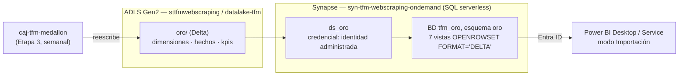
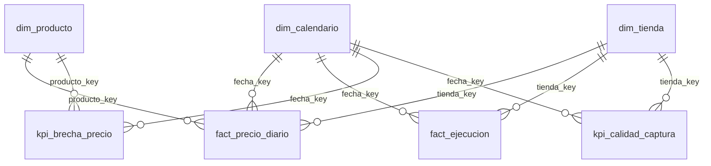

# Etapa 4 — Modelo estrella en Synapse SQL serverless

**Versión:** 0.2 (16 de octubre de 2026). Las vistas están desplegadas y verificadas en Azure sobre los datos del 13 y el 14 de octubre. Se quitó `precio_medio_pago`, hay un tope diario de 1 TB y dos integrantes tienen acceso de lectura.
**Objetivo específico que cubre:** *Diseñar el modelo dimensional (estrella) de la capa oro y exponerlo para el análisis en Power BI.*
**Requerimientos que atiende (Etapa 1):** RF-06, RF-08 (insumo), RNF-04, RNF-05, RNF-07.

---

## 1. Entregables

| Entregable | Ubicación |
|---|---|
| Base de datos `tfm_oro` (collation UTF-8) | `synapse/sql/00_base_de_datos.sql` |
| Acceso al lago con la identidad de Synapse (credencial y fuente de datos `ds_oro`) | `synapse/sql/01_acceso_lago.sql` |
| 7 vistas del modelo estrella sobre las tablas Delta de `oro/` | `synapse/sql/02_vistas_oro.sql` |
| Controles de calidad del modelo (solo lectura) | `synapse/sql/03_verificacion.sql` |
| Permiso de lectura para un usuario de Entra ID | `synapse/sql/04_permiso_usuario.sql` |
| Despliegue y verificación repetibles | `src/nube/sql_serverless.py` |
| Pruebas sin Azure (scripts, variables, una vista por tabla de oro) | `tests/test_sql_serverless.py` |

## 2. Arquitectura



- **No se copian datos.** Cada vista lee la versión vigente de la tabla Delta cuando se consulta, así que no hay que tocar nada después de cada corrida del medallón. El job sube `_delta_log` al final (Etapa 3, sección 9.3), por lo que una consulta nunca ve una versión a medias.
- **Acceso.** SQL serverless lee el lago con la identidad administrada del área de trabajo, que ya tenía *Storage Blob Data Contributor*. Quien consulta las vistas no necesita permisos sobre el lago, solo sobre la base `tfm_oro`.
- **Tipos explícitos.** Las columnas y sus tipos se fijan en `WITH (...)`, sin depender de la inferencia. Los textos tienen un largo acotado, con holgura frente a lo observado; los porcentajes se exponen como `decimal(9,4)`.
- **Collation `Latin1_General_100_CI_AS_SC_UTF8`.** Lee el UTF-8 de Parquet sin conversiones, conserva las tildes (Olímpica, Éxito) y no distingue mayúsculas en los filtros.

## 3. Modelo

Es una constelación: dos tablas de hechos y dos de indicadores comparten las dimensiones de producto, tienda y calendario.



| Vista | Grano | Filas (16-oct) | Contenido |
|---|---|---|---|
| `oro.dim_producto` | producto | 436 | `producto_key` (GTIN-14, o `sitio:sku` si no se emparejó), GTIN, descripción, marca, pulgadas, rango de pulgadas, referencia, tecnología, resolución, `en_maestro` y origen de los atributos (maestro o tienda) |
| `oro.dim_tienda` | sitio | 5 | sitio, tienda y cadena (Alkosto y Ktronix son la misma cadena) |
| `oro.dim_calendario` | día | 2 | fecha, año, mes, semana ISO, día de la semana y fin de semana; va del primer al último día con datos |
| `oro.fact_precio_diario` | producto × tienda × día | 1.800 | precio de lista y de venta, descuento, disponibilidad, stock, método de emparejamiento y trazabilidad (`id_ejecucion`, `ruta_bronze`, `url`) con la última captura del día (RF-06) |
| `oro.fact_ejecucion` | corrida × sitio | 13 | modo, inicio, fin, duración, conteos por estado y estado de la corrida (RF-07) |
| `oro.kpi_brecha_precio` | producto × día | 268 | precio mínimo, máximo y promedio entre cadenas, brecha absoluta y porcentual, y cadena más barata; solo productos con GTIN en al menos 2 cadenas ese día, con stock y sin precio atípico (desde el 19-nov) |
| `oro.kpi_calidad_captura` | tienda × día | 10 | completitud y emparejamiento de la última corrida del día (Etapa 1, sección 10) |

**Cambio frente a la Etapa 1 (sección 9.4):** `precio_medio_pago` se quitó de oro (decisión del equipo, 16-oct) porque estaba vacío en el 100 % de las filas: ninguna tienda lo publica. Sigue en plata y en bronce, por si alguna tienda empieza a publicarlo. El cambio está en `src/medallon/oro.py`, que va en la imagen `tfm-medallon:0.3`; el medallón se volvió a ejecutar con ella (pipeline `df8bf530-…`, ✅ 5,8 min).

**Cambio del 17-oct (Etapa 6):** `oro.fact_precio_diario` tiene una columna nueva, `motivos_atipico` (`varchar(200)`).
- Contiene los motivos de precio atípico separados por coma, o NULL. Las reglas están en `src/medallon/atipicos.py`.
- La columna se calcula en plata. Va en la imagen `tfm-medallon:0.4` (pipeline `9fcbee28-…`, ✅ 4,1 min).
- Las vistas se volvieron a desplegar y la verificación sigue igual. En los dos días hay 4 filas marcadas.

### 3.1 Relaciones para Power BI

- Todas son de **uno a varios**, con filtro en **una sola dirección**, de la dimensión al hecho.
- `kpi_brecha_precio` no tiene tienda, porque compara cadenas. Por eso, el filtro de tienda no la afecta; se filtra por producto (marca, pulgadas, tecnología) y fecha.
- `kpi_calidad_captura` y `fact_ejecucion` no tienen producto.
- `dim_calendario` se marca como tabla de fechas, con la columna `fecha`.

## 4. Despliegue

```powershell
az login --tenant <tenant UNIR>        # cuenta con rol de administrador de Synapse
python -m src.nube.sql_serverless desplegar     # 00, 01 y 02 (idempotente)
python -m src.nube.sql_serverless verificar     # 03
```

- Usa `mssql-python` (driver de Microsoft que trae su propio ODBC 18) con `Authentication=ActiveDirectoryDefault`, es decir, la cuenta de `az login`, sin contraseñas.
- La clave maestra de la base se genera al azar en cada despliegue y no se guarda. Solo protege la credencial, que no tiene secretos (es la identidad administrada).
- **Trampa encontrada:** el ODBC incluido en `mssql-python` no carga desde una ruta con caracteres no ASCII (la carpeta `MAESTRÍA`). Dice *"ODBC driver binaries are missing or incomplete"* aunque estén. Hay que ejecutarlo con un entorno virtual creado fuera de esa ruta, con `PYTHONPATH` apuntando al proyecto. El resto del proyecto no se ve afectado.

## 5. Verificación en Azure (16-oct)

`python -m src.nube.sql_serverless verificar` sobre los datos del 13 y el 14 de octubre:

| Control | Resultado |
|---|---|
| Filas por vista | Iguales a las del resumen del medallón: 436 · 5 · 2 · 1.800 · 13 · 268 · 10 |
| Duplicados de `fecha × producto × tienda` en `fact_precio_diario` (RNF-04) | **0** |
| Duplicados de clave en `dim_producto` y `dim_calendario` | 0 |
| Filas de hechos sin su dimensión (5 relaciones) | **0** |
| Emparejamiento (meta ≥ 80 %) | 13-oct: **87,2 %** (641/735) · 14-oct: **87,2 %** (643/737) |
| Productos comparados entre cadenas y brecha máxima | 134 por día; 40,1 % los dos días |
| Tildes | Olímpica y Éxito se leen bien |

Los resultados coinciden con la lectura directa de las tablas Delta con Spark (Etapa 3, sección 9.5).

**Trazabilidad (RNF-05):** cada fila de `fact_precio_diario` trae `ruta_bronze`, la respuesta original en el lago, e `id_ejecucion`, que se cruza con `fact_ejecucion`.

## 6. Costo

- SQL serverless cobra unos USD 5 por TB procesado, con un mínimo de 10 MB por tabla leída en cada consulta.
- El despliegue y la verificación de esta etapa procesaron **693 MB, unos USD 0,003**. Oro pesa unos 2 MB, así que casi todo es ese mínimo por consulta.
- Una actualización de Power BI en modo Importación lee las 7 vistas una vez, unos 70 MB. Con una actualización semanal el costo es despreciable incluso al final de las 16 semanas.
- **Tope diario de 1 TB** en todo el endpoint, aplicado el 16-oct en `00_base_de_datos.sql` con `sp_set_data_processed_limit` (decisión del equipo). Si un error dispara el consumo, el gasto máximo es de unos USD 5 al día; al superarlo, el endpoint rechaza las consultas hasta el día siguiente. Los topes semanal y mensual siguen sin límite.

## 7. Conexión desde Power BI (insumo para la Etapa 5)

1. *Obtener datos* → **Azure Synapse Analytics SQL**.
2. Servidor `syn-tfm-webscraping-ondemand.sql.azuresynapse.net`; base de datos `tfm_oro`; modo **Importación**.
3. Autenticación: **cuenta de Microsoft (Entra ID)** de UNIR.
4. Seleccionar las 7 vistas del esquema `oro` y crear las relaciones de la sección 3.1.

Para que otro integrante consulte sin ser administrador de Synapse:

```powershell
python -m src.nube.sql_serverless permisos --usuarios correo1@comunidadunir.net,correo2@comunidadunir.net
```

El comando crea el usuario de Entra ID, le da `db_datareader` y `REFERENCES` sobre la credencial con la identidad de Synapse, y se puede repetir sin efectos. Solo acepta correos válidos, porque van dentro del SQL.

**Usuarios con acceso (16-oct):** dos integrantes del equipo con lectura. La cuenta del despliegue es administradora de Synapse.

## 8. Pendientes

1. Etapa 5: tablero de Power BI con menor precio por producto, brecha entre cadenas y evolución diaria, con filtros por marca, pulgadas y tecnología (RF-08).
